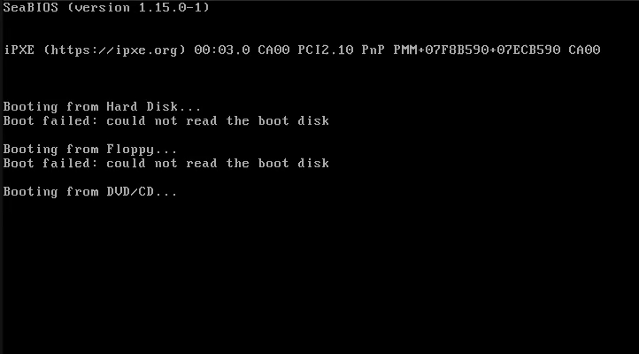

# AerOS
 Official repo for AerOS, written entirely in C and assembly language.
 
 
 
## What is AerOS?
It's an opensource operating system that can execute RenGets both natively and remotely on an external server. The final goal is to have an easy to use programming interface that incoperates functionality from the programming language "RenLang". 

## But why basic C?
It offers a programming interface that is more convient than assembly language. However, assembly language will be used to implement core functionality as that is the only way this can be accomplished. 

## Why not just use the Linux kernel?
Building an operating system from the ground up that can run on bare metal is quite the accomplishment. By using a custom codebase, AerOS can be made far more versitile and even faster than Linux. AerOS is supposed to be the prime example of what a perfectly balanced platform should look like; with the implementation of only running RenGets that meet our specifications. 

## Where's the assembly?
I've decided to use inline assmembly in C with the GCC GNU99 standard for the most part when developing this operating system to keep things a little bit cleaner. Also, this allows me to break into assembly whenever I may need to do so without having to compile external files. 

## Tools Used
- Visual Studio Code IDE
- Ubuntu 22.04 LTS
- GCC GNU99
- NASM X86 ASM
- Qemu i386 & Virtual Box
- GNU GRUB
- Makefile
- OS Dev Wiki: https://wiki.osdev.org/Main_Page 

## To-Do List
- [x] Successful build for printing text.
- [x] Implement boot process that calls the main methods.
- [x] Implement a memory pool and a way to assign / un-assign memory. (4MB kernel heap: malloc / free / realloc)
- [x] Hardware drivers for user input. (PS/2 keyboard on IRQ1)
- [x] Switch to interrupt instead of maths for delays. (PIT timer at 1000Hz)
- [x] Sound driver for error reporting. (PC speaker beep)
- [x] Implement local filesystem. (FAT16 / FAT32 on IDE disks labelled AEROS, temporary VFS without one)
- [x] Process management.
- [ ] Programming interface. 🚧
- [ ] Graphics driver. 🚧
- [ ] Ethernet network driver.
- [ ] More in the pipeline coming soon..
