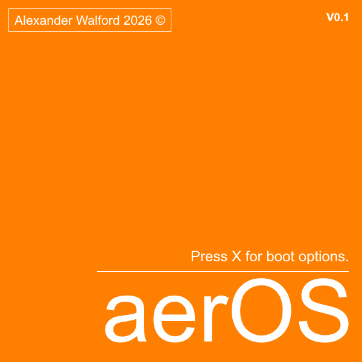

# aerOS
Official repo for AerOS, written entirely in C and assembly language.
 
 
 
## What is AerOS?
It's an opensource operating system and its design is remarkably simple considering the feature set. That's one of the major selling points.

Like many other operating systems, apps that shape the user experience can be edited in realtime. If you don't like how the text editor works, change it using said editor and save your changes. Then reload the app to test said changes immediately. No recompiling needed.

## What makes it different
- **It explains itself.** Type `why` after anything goes wrong and AerOS tells you what happened, why, and what to do. `why del` explains a command from the comments in its own source code, `src del` shows that code, and the whole source is built in as the read-only `/src/` folder.
- **The prompt is a programming language.** Anything that isn't a command runs as AerLang: `let x = 2`, `x * 10`, `for f in la() do print(f) end`. `cmd("la")` turns a command's output into data.
- **Apps ask before they touch your files.** Programs read AerOS's own files freely, but ask before reading yours or changing anything (yes, always, or no).
- **Files remember their past.** Changing or deleting a file in your home folder keeps the old version: `vers notes.txt`, `rd notes.txt@2`, `undo notes.txt`.
- **The network sends nothing readable.** Every message is sealed (AES-256 and an HMAC tag) with a password both ends know, and the firewall blocks everything until you allow an address (or name) and port yourself: `fw allow 10.0.2.2 5000`, then `msg 10.0.2.2 5000 hello`.
It's an opensource operating system and its design is remarkably simple considering the feature set. That's one of the major selling points. 

Like many other operating systems, apps that shape the user experience can be edited in realtime. If you don't like how the text editor works, change it using said editor and save your changes. Then reload the app to test said changes immediately. No recompiling needed.

## Documentation
AerOS is written to be read. Every source file starts with an explanation of what it does and how, and these guides tie it all together:

- [What makes AerOS different](docs/DIFFERENT.md): how WHY and SRC, AerLang at the prompt, permissions and file versions work inside
- [The network](docs/NETWORK.md): the e1000 driver, the firewall, sealed messages, and `tools/aernet.py` for the other end
- [How AerOS works](docs/ARCHITECTURE.md): the source tree, the boot sequence, memory, interrupts, files, and recipes for adding commands, functions and drivers
- [AerLang](docs/AERLANG.md): the built-in programming language
- [Security](docs/SECURITY.md): user accounts, password hashing and file encryption, with every algorithm explained
- [Sound](docs/AUDIO.md): the AC'97 driver and WAV / MP3 playback

## But why basic C?
It offers a programming interface that is more convient than assembly language. However, assembly language will be used to implement lower level functionality as that is the only way this can be accomplished. 

## Why not just use the Linux kernel?
Building an operating system from the ground up that can run on bare metal is quite the accomplishment. By using a custom codebase, AerOS can be made far more versitile and even faster than Linux. AerOS is supposed to be the prime example of what a perfectly balanced platform should look like; with the implementation of only running RenGets that meet our specifications. 

## Where's the assembly?
I've decided to use inline assmembly in C with the GCC GNU99 standard for the most part when developing this operating system to keep things a little bit cleaner. Also, this allows me to break into assembly whenever I may need to do so without having to compile external files. 

## Tools Used
- Visual Studio Code IDE
- Ubuntu 22.04 LTS
- GCC GNU99
- NASM X86 ASM
- Qemu i386 & Virtual Box
- GNU GRUB
- Makefile
- OS Dev Wiki: https://wiki.osdev.org/Main_Page 

## To-Do List
- [x] Successful build for printing text.
- [x] Implement boot process that calls the main methods.
- [x] Implement a memory pool and a way to assign / un-assign memory. (kernel heap: malloc / free / realloc, a 4MB pool plus the free RAM found at boot)
- [x] Hardware drivers for user input. (PS/2 keyboard on IRQ1)
- [x] Switch to interrupt instead of maths for delays. (PIT timer at 1000Hz)
- [x] Sound driver for error reporting. (PC speaker beep)
- [x] Implement local filesystem. (FAT16 / FAT32 on IDE disks labelled AEROS, temporary VFS without one)
- [x] Process management.
- [x] Programming interface. (AerLang: an interpreter, a prompt and a text editor, see docs/AERLANG.md)
- [x] Graphics driver. (framebuffer console, pixels, shapes, text and BMP pictures for apps)
- [x] User accounts. (login screen, passwords stored as salted PBKDF2 hashes)
- [x] File encryption. (ENC / DEC, AES-256 with an HMAC tag)
- [x] Audio. (AC'97 sound card, PLY for WAV and MP3 files using minimp3, and a startup sound in /sys/startup.wav that you can replace)
- [x] A manual inside the OS. (DOC opens /docs/ in a Markdown / HTML / text reader written in AerLang)
- [x] System information. (SYSINFO shows the processor, memory, screen, disks, sound card and every PCI device)
- [x] Animations. (progress bars and spinners for long jobs like DEL, ENC and PLY, and progress / spinner / frame in AerLang)
- [x] A program queue. (QUE lines programs up on the process stack and GO runs them one after another)
- [x] Scrollback. (Page Up / Page Down in the terminal look back through the last 400 lines of output)
- [x] Games groundwork. (a back buffer for smooth drawing, held keys, and a mixer playing up to 8 sounds at once)
- [x] Video. (PLY plays MPEG-1 .mpg videos full screen with their sound in step, using pl_mpeg; see docs/VIDEO.md)
- [x] An OS that explains itself. (WHY explains problems, commands and functions, SRC shows the code, /src/ holds it all)
- [x] AerLang at the prompt. (variables, sums and code right in the terminal, "did you mean", and cmd() for a command's output)
- [x] Programs ask first. (apps ask before reading your files or changing any, PERM remembers the answers)
- [x] File versions. (the last 10 versions of every file in a home folder: VERS, file@N and UNDO)
- [x] Ethernet network driver. (Intel e1000, sealed messages only, and a firewall that blocks everything until FW ALLOW; see docs/NETWORK.md)
- [ ] More in the pipeline coming soon..
