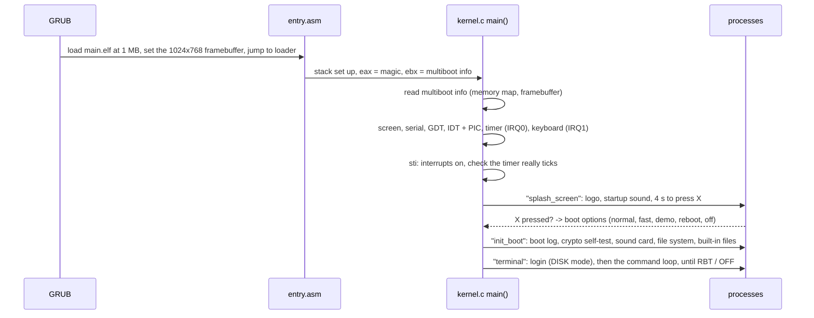

# How AerOS works

A guide to the whole system: what each part does, how a boot unfolds, where everything lives
in memory, and how to change things. Every source file starts with a comment explaining itself
in more detail. This document is the map that ties them together.

The other guides go deeper into one area each:

* [NETWORK.md](NETWORK.md): the network card, the firewall, and the sealed messages that are
  all AerOS will send
* [DIFFERENT.md](DIFFERENT.md): what sets AerOS apart (WHY and SRC, AerLang at the prompt,
  apps that ask first, files that remember), and how each one works
* [AERLANG.md](AERLANG.md): the AerLang programming language and its built-in functions
* [SECURITY.md](SECURITY.md): user accounts, password hashing and file encryption
* [AUDIO.md](AUDIO.md): the sound card driver, WAV / MP3 playback and the mixer
* [VIDEO.md](VIDEO.md): playing MPEG-1 videos, and keeping picture and sound together

## The idea

AerOS is meant to be **small enough to understand completely** and **fast because it does so
little**. It leaves out the machinery a general-purpose OS needs for many programs and many
users at once:

| Left out | What AerOS does instead | What that buys |
| --- | --- | --- |
| paging / virtual memory | every pointer is a physical address | no page tables, no TLB misses, nothing to set up |
| multitasking and context switches | one thing runs at a time, to completion | no scheduler overhead, no locks |
| a kernel / user split | everything runs in ring 0 | no system call overhead, drivers are ordinary functions |
| loadable drivers and modules | every driver is compiled in | the whole OS is one ~1.8 MB file (half of it its own source code, for `/src/`) |
| a C library | `src/lib` has just what the kernel uses | no unused code (`--gc-sections` removes the rest) |

The cost is just as clear. A bug anywhere can crash everything, and there is no protection
between programs. AerOS treats this as a fair trade for a system meant to be read, learned
from and modified.

Four things set it apart from the usual design (each is described in full in
[DIFFERENT.md](DIFFERENT.md)):

| Idea | What you see | The code |
| --- | --- | --- |
| it explains itself | `why` after a problem, `why del`, `src del`, the read-only `/src/` folder | `sys/explain.c`, `sys/source.c` |
| the prompt is AerLang | `let x = 2`, `x * 10`, `cmd("la")` at the terminal's prompt | "The shell" in `lang/aer_interp.c` |
| apps ask first | "viewer.aer wants to read files in /home/alex/" | `sys/perm.c` |
| files remember | `vers notes.txt`, `rd notes.txt@2`, `undo notes.txt` | `sys/versions.c` |

## The source tree

```
src/
  entry.asm             multiboot header (asks GRUB for 1024x768x32), sets up the stack, calls main()
  kernel.c              main(): starts the hardware, then runs the boot processes in order
  linker.ld             puts the kernel at 1 MB, header first
  Makefile              builds main.elf and main.iso, runs QEMU (make run / run-vfs / run-uefi)

  drivers/              talking to hardware
    input/    IO.c        PS/2 keyboard: scancodes -> ring buffer -> getk / getln / GetSecret
              mouse.c     PS/2 mouse on IRQ12, only on while a program uses it (mouse() in AerLang)
              GIO.h       inb / outb port I/O and other one-instruction helpers
    video/    VGA_linear.c  the text console: VGA text mode, or 80x25 cells drawn on a framebuffer
              gfx.c       pixels, rectangles, lines, text, BMP pictures and scaled pixel blocks for
                          apps, drawn straight to the screen or into a back buffer (gfx_show)
              bga.c       changing resolution on QEMU / Bochs / VirtualBox graphics (RES command)
              font8x16.c  the console font
    storage/  ata.c       IDE / ATA disks, read and write sectors (PIO)
    pci/      pci.c       finding devices on the PCI bus
    audio/    ac97.c      the AC'97 sound card (whole sounds, or a stream topped up from the timer)
              tone.c      the PC speaker (BP)
    serial/   serial.c    COM1: everything printed on screen is copied here, for debugging
    net/      e1000.c     the Intel e1000 network card: Ethernet frames in and out (polled)

  sys/                  the operating system proper
    boot.c                reads GRUB's multiboot info, prints the boot log
    interrupts.c          GDT, IDT, PIC remapping, exception and IRQ dispatch
    sys_clck.c            the PIT timer (1000 Hz) and the CMOS real time clock
    p_man.c               the process manager (a queue of one-line jobs)
    f_sys.c               the file system front end: DISK mode or the in-memory VFS
    fat.c                 the FAT16 / FAT32 driver
    source.c              the read-only /src/ folder: AerOS's own source, built into it
    versions.c            old versions of the files in home folders (VERS, UNDO, notes.txt@2)
    perm.c                programs ask before they touch your files (PERM)
    net.c                 the network stack: ARP, IPv4, UDP, DNS lookups (NET, MSG, LSN)
    firewall.c            the firewall's rules, everything blocked until FW ALLOW
    netseal.c             sealed messages: the only thing ever sent over the network
    appmode.c             app mode: a program gets the memory of the parts of AerOS it doesn't use
    rt.c                  RT mode (boot option 6, experimental): real-time tasks from the timer
    explain.c             WHY and SRC: the last problem, its explanation, and reading the source
    fcrypt.c              password protected files
    sound.c               WAV / MP3 decoding and playback
    mixer.c               up to 8 sounds at once, in the background (games, a video's sound track)
    video.c               the .mpg video player (PLY, AerLang's video())
    sysinfo.c             everything known about the computer (CPU, memory, disks, PCI), for SYSINFO
    ui.c                  progress bars and spinners for long jobs (and AerLang's progress / spinner)
    apps.c                the built-in apps and files, copied to the disk at boot
    splash.c              the orange boot screen
    recovery.c            the boot options menu (press X on the splash)
    power.c               reboot and shut down
    accounts/auth.c       user accounts and the login screen
    terminal/t_int.c      the terminal: the prompt, the table of every command, Tab, HLP
    terminal/commands.h   which cmd_ file holds which command, and how to add one
    terminal/cmd_files.c  LA, SD, RD, MKF, WR, DEL, VERS, UNDO, ENC, DEC, EDT
    terminal/cmd_*.c      the other commands by topic: _accounts, _system, _network,
                          _programs (RUN, QUE, GO), _help (DOC, WHY, SRC, SHOW)
    trace.c               notes on what AerOS does, for SHOW (TRACE() in the code)
    terminal/editor.c     the text editor (EDT)

  lib/                  the kernel's own small C library
    aer_string.c          memcpy, slen, strtok_r, sdist  aer_stdlib.c  malloc / free, itoa, qsort...
    aer_stdio.c           prtf, sfmt                 aer_ctype.h   isdigit, toupper...
    aer_setjmp.c          setjmp / longjmp (AerLang errors) primary_definitions.c  seq, split, trim
    crypto.c              SHA-256, HMAC, PBKDF2, AES-256, random numbers
    busy.c                busy(): long loops call it so a spinner can turn (see sys/ui.h)
    mp3.c + minimp3/      MP3 decoding
    mpg.c + pl_mpeg/      MPEG-1 video and MP2 sound decoding (pl_mpeg, MIT)
    fpu.c                 switches the x87 FPU on, for decimal numbers (AerLang's, the decoders')
    aer_math.c            sqrt, sin, cos, atan2, floor on the x87, and decimals to text and back
    shim/                 <string.h> and <stdlib.h> for the decoders, pointing at the files above
    aer_comp.c            runs a process's line of code (the built-in "instructions")

  lang/                 the AerLang interpreter
    aer_lexer.c           source text -> tokens
    aer_parser.c          tokens -> syntax tree
    aer_interp.c          walks the tree; memory, values, variables; the shell's session
    aer_builtins.c        the table of every function a program can call, and the constants
    builtins.h            how the built-ins are laid out, and how to add one
    bi_args.c             checking a built-in's arguments (and asking permission for files)
    bi_text.c, bi_lists.c, bi_files.c, bi_screen.c, bi_graphics.c, bi_sound.c, bi_system.c,
    bi_network.c          the built-ins themselves, by topic: print, rdf, gopen, play, mouse...

  disk/                 the files built into AerOS, laid out as they are in it: disk/bin/ is /bin/
                        (apps, and games in bin/games/), disk/docs/ the manual DOC shows,
                        disk/sys/ the startup sound. Copied there at every boot (sys/apps.c)
  iso/boot/grub/grub.cfg  GRUB's menu: loads main.elf, restores the saved screen resolution
```

## A boot, step by step



Each step after the hardware set-up is a **process**: a line of code (`"splash_screen"`,
`"init_boot"`, `"terminal"`) put on the process stack and handed to `compile()` in
`lib/aer_comp.c`, which knows what each name means. Processes run one at a time to completion,
shortest first. The terminal's `RUN` command creates processes the same way.

Since nothing runs side by side, programs can instead be **queued** to run one after another:
`QUE <program>` (or AerLang's `queue()`) puts a process on the stack as WAITING, and `GO`
runs the waiting ones in the order they were queued, each to completion. Ctrl+C in one of them
stops the rest of the queue as well. See "The queue" in `sys/p_man.h`.

## Memory

There is no paging, so these are the real physical addresses:

```
0x00000000  +---------------------------+
            | BIOS data, real mode IVT  |  left alone
0x000B8000  | VGA text buffer           |  the console in text mode (80 x 25 x 2 bytes)
0x00100000  +---------------------------+  1 MB
            | .text   code              |
            | .rodata constants         |  the kernel, about 430 KB
            | .data   globals           |
            | .bss    256 KB stack      |
            |         4 MB heap pool    |
            +---------------------------+  end of the kernel
            | free RAM                  |  the biggest free stretch in GRUB's memory map is
            |   (added to the heap)     |  handed to heap_add_region() at boot
            +---------------------------+  end of RAM
   ...
0xFD000000  | framebuffer (typically)   |  wherever GRUB says, used as a plain pointer
            +---------------------------+
```

* **The stack** (256 KB) is shared by everything, including interrupt handlers. Code that might
  recurse deeply (the AerLang parser and interpreter) checks how much is left.
* **The heap** (`malloc` / `free` in `lib/aer_stdlib.c`) is "next fit" with a 16-byte header
  per block. `malloc` carries on searching from where it last allocated, and `free` merges a
  block with its free neighbours in constant time. It starts with the 4 MB pool inside the kernel and grows by the free
  RAM found at boot, about 250 MB on a 256 MB machine.
* **DMA** (the sound card) works with ordinary heap pointers, because without paging every
  address the CPU sees is the address the hardware sees.

## Interrupts

| Vector | Source | Handler |
| --- | --- | --- |
| 0-31 | CPU exceptions (divide by zero, page fault...) | the red panic screen, with the exception's name |
| 32 (IRQ0) | PIT timer, 1000 times a second | counts milliseconds, adds entropy for the random generator |
| 33 (IRQ1) | PS/2 keyboard | scancode -> character -> ring buffer, adds entropy, Ctrl+C sets a break flag |

Waiting is done with `hlt` until the next interrupt (`sleep_ms`), so an idle AerOS uses almost
no CPU. If the firmware has switched the PIT off, `clck_verify()` notices at boot and every wait
becomes a busy loop instead (about a millisecond per 1000 port writes, so timing is rough).

## Files

`src/sys/f_sys.c` is the only file system interface the rest of the OS uses. At boot it picks
one of two modes:

| Mode | When | Files go to |
| --- | --- | --- |
| DISK | an IDE disk with a FAT16 / FAT32 volume labelled `AEROS` is found | the disk (`fat.c`) |
| VFS | no such disk, or DEMO mode chosen in the boot options | memory, lost at power off |

Paths are always absolute directories ending in `/` plus a name (`"/sys/"` + `"conf.aer"`).
Users can type relative paths with `.` and `..`, and `fs_split_path` / `fs_resolve_dir` turn
them into that form. On disk, new names must fit 8.3 (`NOTES.TXT`). Existing long names can be
read.

Each user's home folder is `/home/<name>/`, made with the account. The folders made at every
boot are `/acc/` (accounts, and `perms`, what programs may always do), `/bin/` (apps), `/docs/`
(the manual), `/sys/` (system files: `startup.wav`, `cache/`, `tmp/`) and `/conf.aer`.

Three things are layered on top, all inside `f_sys.c`'s public functions, so every command
and every AerLang function gets them without doing anything:

* **`/src/`** is neither on the disk nor in memory: each function checks `source_in()` first
  and hands the path to `sys/source.c`, which serves AerOS's own source files from the kernel.
  Anything that would change one gets `FS_ERR_READ_ONLY`.
* **Versions**: before a file in a home folder is changed or deleted, `versions_keep()`
  (`sys/versions.c`) copies it into `/home/<name>/versions/`. A name like `notes.txt@2` that
  isn't a real file is read from there instead. Writing with `wipe_old` (encryption) deletes
  a file's versions, and `fs_empty_dir` pauses versions while it works.
* **Permissions** aren't in `f_sys.c`: they are checked one level up, by AerLang's file
  functions, so the terminal (which is you) never asks. See `sys/perm.h`.

## The manual inside AerOS

`src/disk/docs/` holds the manual that ships inside the OS: short Markdown pages written for an
80-column screen, plus an HTML sample. They are linked into the kernel like the apps and
copied to `/docs/` at boot. Each page is **replaced whenever it differs** from the built-in
copy, so the manual always matches the version that is running.

The apps are more careful, because they are yours to change. `/sys/apps.lst` records the
SHA-256 of each app as AerOS installed it. At boot an app on the disk that still matches its
record is replaced by a newer built-in version, and one that doesn't (you changed it) is kept.
Apps installed before the record existed are kept too, since there is no way to tell. See
the top of `sys/apps.c`.

`DOC [topic]` opens it in the reader, `/bin/read.aer`. The reader is an AerLang app that shows
Markdown, HTML and plain text with colours, word wrapping, tables and links (Tab picks a link,
Enter opens it, Backspace goes back). To change a page, edit it in `src/disk/docs/` and rebuild. To
add one, put it there too and link to it from `index.md`: nothing else needs changing.

## The terminal

`cli_init()` in `sys/terminal/t_int.c` is the main loop of the running system:

```
loop forever:
    auth_login()          (DISK mode only), then start the shell's AerLang session
    draw the banner
    until OUT (log out):
        prompt "alex@0//: "  ->  read a line  ->  the first word is:
                                                    a command in commands[]    run it
                                                    an app, /bin/<word>.aer    run that
                                                    anything that looks like code: AerLang
                                                    anything else: "Did you mean DEL?"
```

Everything about a command's name comes from that one table: `HLP` (help) lists it, Tab
completion offers it, its "Usage:" message is built from it, and `WHY` / `SRC` find its code
through it (each row keeps its function's name as a string, see the `COMMAND` macro). So a new
command only needs one table line, and renaming a command means changing one word. Text in
other files that names a command (`sys/explain.c`) writes `@cli_list` and gets the current
name from `cli_command_called()`.

Commands report problems with `explain_say()` / `explain_say_fs()` (`sys/explain.h`) rather
than a plain `prtf`: the message looks the same, but AerOS remembers it, so `WHY` can explain
it afterwards. The line is read with
`GetLine()` (in `drivers/input/IO.c`), which hands Tab to `cli_complete()`. That completes
the first word from the command table and the `.aer` programs in `/bin/` and the current
folder, and later words from the file system.

## AerLang

```
source text --aer_lexer.c--> tokens --aer_parser.c--> syntax tree --aer_interp.c--> runs it
                                                                        |
                                       aer_builtins.c's table -> bi_*.c: print, rdf, play...
```

The interpreter tracks every allocation, so when a program ends, normally or through an error,
everything it used is freed at once. Errors `longjmp` straight back to the start of the run.
See [AERLANG.md](AERLANG.md) for the language and the comments at the top of each `lang/` file
for the details.

The terminal's prompt has an AerLang session of its own, "the shell", which lasts from logging
in to logging out. Only one session can be the running one, so when a program starts, the
shell's session is copied aside and copied back when the program ends ("The shell" in
`aer_interp.c`). Once a program is parsed, and before it runs, its tokens give its profile
(the built-ins it names, `aer_profile`), and `appmode_begin()` (`sys/appmode.c`) puts away the
parts of AerOS it won't use. A part that keeps memory while idle should be added there. Programs go through `aer_run_file()`, which also tells `sys/perm.c` which
program is running, so its file functions ask before they touch your files.

## Building and testing

```bash
cd src
make            # builds main.elf and main.iso (needs gcc-multilib, nasm, grub, mtools: make setup-dev)
make run        # boots the ISO in QEMU with a 64 MB AEROS disk (disk.img) and an AC'97 sound card
make run-vfs    # without a disk
make run-uefi   # as a UEFI PC (OVMF)
make disk-put FILE=photo.bmp DIR=/bin   # copy a file onto the disk
make check      # check the code keeps the conventions WHY and SRC rely on (see Style, below)
make test       # boot AerOS in QEMU and check it works (see TESTING.md)
```

The kernel is built with `-Os -ffunction-sections -fdata-sections` and linked with
`--gc-sections`, so any function nothing calls is left out. There are no warnings, and new code
should keep it that way. Useful QEMU options while testing:

* `-kernel main.elf` boots without GRUB (faster, and the screen stays in VGA text mode, so its
  text can be read from memory at `0xB8000` with the QEMU monitor's `pmemsave`)
* `-serial stdio` shows everything printed on screen in your terminal
* `-audiodev wav,id=snd0,path=out.wav -device AC97,audiodev=snd0` records the sound card to a file

## Recipes

### Add a terminal command

The commands live in `src/sys/terminal/cmd_*.c`, one file per topic (the top of `commands.h`
says which holds which). Write the command in the file for its topic, here `cmd_system.c`:

```c
// VER: print the version
void cli_version (char* arguments) {
    (void)arguments; // VER takes no arguments
    prtf("AerOS " AEROS_VERSION "\n");
}
```

declare it in `commands.h` with the others from that file, and add one line to `commands[]` in
`t_int.c`: the name you type, what goes after it (for help and the "Usage:" message, "" if
nothing), the description help shows, and the function:

```c
    COMMAND("ver",  "",           "PRINT THE AEROS VERSION",                                    cli_version),
```

A command that needs something after it can call `show_usage(NULL)` when it is missing, which
prints e.g. `Usage: VER` built from the table. When something goes wrong, say so with
`explain_say(PROBLEM_..., subject, "Couldn't ...")`, or `explain_say_fs(result, subject,
"Couldn't ...")` for a file system result code, so `WHY` can explain it. The comment above the
function is what `WHY VER` shows, so write it for the person typing the command. Where your
code decides something worth knowing, a `TRACE("...")` line says so for `SHOW VER`.

### Explain a new kind of problem

Add a `PROBLEM_` to the list in `src/sys/explain.h`, and its explanation to the table in
`src/sys/explain.c`: what happened, why AerOS works that way, what to do about it, and the C
function that makes the decision (for `SRC`). Write commands as `@cli_function` so they are
named whatever the command is called today.

### Add an AerLang function

The built-ins are in `src/lang/bi_*.c`, one file per topic (`bi_text.c`, `bi_files.c`,
`bi_graphics.c`...: the top of `src/lang/builtins.h` lists them). Write the function in the file
for its topic:

```c
// twice(n): n times two
value_t bi_twice (int argc, value_t* argv, int line) {
    (void)argc;
    return aer_int(int_arg(argv, 0, line, "twice") * 2);  // int_arg reports a wrong type for you
}
```

declare it in `builtins.h` with the others from that file, add
`BUILTIN("twice", bi_twice, 1, 1),` to `aer_builtins[]` in `aer_builtins.c` (name, function,
fewest and most arguments), and list it in [AERLANG.md](AERLANG.md). The comment above it,
starting with how it is called, is what `WHY TWICE` shows.

A function that takes a file's path gets it with `file_arg(..., PERM_READ or PERM_CHANGE, ...)`
(or `allowed_path`), which asks the person at the keyboard if the program needs permission,
and fails the same way as a missing file if the answer is no.

### Add a built-in app or file

Everything in `src/disk/` is built into AerOS and copied to the same place in AerOS every time
it starts, so it is there on every computer and every new disk. The folder is laid out just
like AerOS's own:

| In the repository | In AerOS |
| --- | --- |
| `src/disk/bin/hello.aer` | `/bin/hello.aer` |
| `src/disk/bin/games/snake.aer` | `/bin/games/snake.aer` |
| `src/disk/docs/index.md` | `/docs/index.md` |
| `src/disk/sys/startup.wav` | `/sys/startup.wav` |

Using `snake.aer` as the example:

1. **Name it.** On a FAT disk a name must fit 8.3: up to 8 letters or digits, a dot, up to 3
   more (`snake.aer` is fine, `snakegame.aer` isn't). The name is also how it is run (`snake`),
   so check it isn't already a command (`HLP` lists them): a command always wins.
   **Pick its folder:** games go in `/bin/games/`, other apps in `/bin/`. Both are searched
   when an app is run by its name (`aer_app_folders` in `lang/aerlang.h`, `/bin/` first), and
   by Tab completion. To add another folder for apps, make it at boot (`make_base_folders` in
   `sys/f_sys.c`) and add it to `aer_app_folders`. If an app moves to a new folder, the old
   copy an earlier AerOS left in `/bin/` is deleted on the next boot, unless it was changed.
2. **Put it in `src/disk/bin/games/`.** That is all: nothing else needs changing. The Makefile
   picks up every file under `src/disk/`, wraps each in an object file with `ld -b binary`
   (which gives two symbols for its first and last byte, `_binary_disk_bin_games_snake_aer_start`
   and `_end`), and writes the table of them, `builtin_files[]`, into `obj/builtin_index.c`.
   Files in `/docs/` are *refreshed* (replaced whenever they differ, so the manual matches the
   running AerOS). Everything else is an app or system file: a copy someone has changed on their
   disk is kept, and only an untouched one is replaced by a newer version (see the top of
   `sys/apps.c`).
3. **Build and run it:** `make run` (in `src/`). The boot log's `APPS` line counts what was
   added, and then `snake` runs it, Tab completes its name, and `read /bin/games/snake.aer`
   shows it. On your own disk image it is added on the first boot after the build, because it
   isn't there yet.
4. **Optional:** list it in the manual (the app table in `src/disk/docs/aerlang.md`) and in the
   README.

To try an app on your own disk without building it in, copy it there instead:
`make disk-put FILE=disk/bin/games/snake.aer DIR=/bin/games`. It isn't then on new disks, or in
the repository.

### Add a real-time task (RT mode)

RT mode (boot option 6, `src/sys/rt.h`) runs a few C functions from the timer interrupt, each
every `period` milliseconds and within a `budget` of microseconds:

```c
// blink: toggle a pin (or a counter) every 20ms, never more than 30us a run
static void blink (void) {
    blinks++;
}
...
rt_add("blink", 20, 30, blink);   // after rt_start(), e.g. at the end of rt_start itself
```

`rt_add` refuses a task if the tasks together could miss a deadline (the rate monotonic
bound: the sum of budget / period must stay under n * (2^(1/n) - 1)). Every run is timed with
the processor's cycle counter, and after `RT_OVERRUNS_MAX` runs over budget the watchdog stops
the task. `RT` lists them all with their worst time. A task runs inside the timer interrupt:
it must be short, must not allocate memory or wait for anything, and must always return
(the watchdog can't stop a run that never ends). Tasks don't interrupt each other: each
millisecond the due ones run in order, shortest period first.

### Add a driver

1. Put it in `src/drivers/<kind>/` (any `.c` file there is built automatically).
2. For a PCI card, find it with `pci_find_class()`, read its ports with `pci_io_bar()`, and call
   `pci_enable_io_and_dma()`.
3. Call its init function from `kernel.c` (if it needs to run before interrupts are on) or from
   `init_boot()` in `sys/boot.c`, and print a `[ OK ]` / `[WARN]` line in the boot log.
4. If it needs an interrupt, install a handler with `irq_install_handler(n, fn)` and
   `pic_unmask(n)` (see the timer in `sys/sys_clck.c`).

### Style

* Every file starts with a comment saying what it is for and how it works.
* Every function has a comment right above it (no blank line in between): `WHY` reads them,
  so they are the explanation people see inside AerOS. A function's definition is one line,
  starting at column 0 with its return type and ending with its `{`, `int fs_list (...) {`, and
  its closing `}` is at column 0: that is how `SRC` finds where it starts and ends. `make check`
  (`tools/check.py`) checks all three, and says where anything breaks them.
* Where a function decides something or does something worth knowing, a `TRACE("...")` line
  says so in plain words, for `SHOW` (see `src/sys/trace.h`).
* Comments explain **why**, and anything that isn't obvious from the code: the hardware's rules,
  the edge cases, the reasons for a choice.
* Functions return a value or an `*_OK` / `*_ERR_*` code with a matching `*_strerror()` message.
  There are no hidden globals for errors.
* Secrets are wiped with `wipe()` as soon as they're no longer needed.
* Builds must stay free of warnings.
