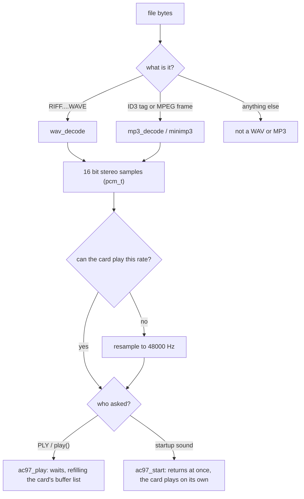

# Sound in AerOS

AerOS plays WAV and MP3 files through an Intel AC'97 sound card, and plays a chime on the
splash screen when it starts. This document explains how sound gets from a file to the
speakers, and how to change or extend it.

| File | What it does |
| --- | --- |
| [`src/drivers/pci/pci.c`](../src/drivers/pci/pci.c) | finds the sound card on the PCI bus |
| [`src/drivers/audio/ac97.c`](../src/drivers/audio/ac97.c) | the AC'97 driver: volume, sample rate, playing samples from memory |
| [`src/sys/sound.c`](../src/sys/sound.c) | reads WAV files, calls the MP3 decoder, converts sample rates, the startup sound |
| [`src/lib/mp3.c`](../src/lib/mp3.c) | a small wrapper around minimp3 |
| [`src/lib/minimp3/`](../src/lib/minimp3/) | minimp3, unchanged (public domain, CC0) |
| [`src/drivers/audio/tone.c`](../src/drivers/audio/tone.c) | the old PC speaker beeper (`BP`), separate from all of the above |

## Using it

| Where | How |
| --- | --- |
| terminal | `PLY song.mp3`, `PLY /sys/startup.wav` (Esc or Ctrl+C stops it) |
| AerLang | `play("song.mp3")` waits until it finishes, false if it can't be played |
| boot | `/sys/startup.wav` plays while the splash screen is up |
| QEMU | `make run` adds an AC'97 card played through PulseAudio. Use `make run AUDIO=none` if that isn't available |

To copy a file from your computer onto the AerOS disk, from `src/` in WSL:

```bash
make disk-put FILE=/mnt/c/Users/you/Music/song.mp3
```

## From a file to the speakers



The whole sound is decoded into memory first, then played. That keeps every piece simple and
means playback never stutters because the CPU fell behind. A minute of stereo at 44.1 kHz is
about 10 MB, and AerOS gives the heap all the free RAM it finds at boot.

### What can be played

| Format | Supported |
| --- | --- |
| WAV, PCM | 8 bit (unsigned), 16, 24 and 32 bit (signed); mono or stereo (extra channels are dropped); any sample rate |
| WAV, "extensible" | yes, when the sub-format is PCM |
| WAV, float or compressed (ADPCM, A-law...) | no |
| MP3 | MPEG 1, 2 and 2.5 layer 3, plus layers 1 and 2; any bit rate including VBR; ID3v2 tags are skipped |

MP3 is free to use: its last patents ran out in 2017. minimp3 is in the public domain.

### Sample rates

Every AC'97 card plays 48000 Hz. Most can also play other rates ("variable rate audio", VRA)
between 8000 and 48000 Hz. AerOS asks for the file's own rate and uses whatever the card
reports back. If it doesn't match (no VRA, or a 96 kHz file), `resample()` converts the sound
by drawing straight lines between neighbouring samples:

```
input frames:      a         b         c
                   |----x----|---------|        x = where output frame n falls, e.g. 1.25 frames in
output sample  =   a + 0.25 * (b - a)
```

The position moves along in 16.16 fixed point (whole frames in the top bits, the fraction in
the bottom 16), so each output frame costs one addition and a multiply, with no floating point.

## The AC'97 driver

An AC'97 card has two sets of I/O ports, found through its PCI base address registers:

| | BAR | Used for |
| --- | --- | --- |
| NAM (mixer) | 0 | reset, master / headphone / PCM volume, the sample rate |
| NABM (bus master) | 1 | the PCM out DMA engine: descriptor list, current index, last valid index, status, control |

The card plays sound **straight from memory by itself (DMA)**, so the CPU only has to point it
at the samples. It reads a list of 32 *buffer descriptors*, each giving an address and a length
(at most 65 534 samples):

```
descriptor:  0     1     2     3    ...   31
points at:   c32   c33   c2    c3   ...   c31      c = chunk of the sound (4096 frames, ~85 ms)
              ^           ^
         refilled    CIV: the one playing now           LVI: the last one that's ready
```

The card plays descriptor `CIV`, moves on to the next one (31 wraps round to 0), and stops after
`LVI`. **`ac97_play`** keeps a sound of any length going. It checks every 5 ms, and when `CIV`
has moved past a descriptor it points that descriptor at the next unplayed chunk and makes it
the new `LVI`. The card never catches up until the last chunk is queued, then plays to the end
and halts. Nothing is copied: the descriptors point straight into the decoded sound.

**`ac97_start`**, used for the startup sound, gives each descriptor the most it can hold (32 767
frames) and returns at once. Up to about 21 seconds then plays with no help from the CPU while
AerOS carries on booting. Any later `PLY` stops it first.

If the card stops moving for 2 seconds, `ac97_play` gives up with "the sound card stopped
responding", so a broken card can't hang the OS.

### Streaming, and the mixer

`ac97_play` needs the whole sound decoded in memory first. Games and videos make their sound as
they go, so the driver also has a **streaming** mode (`ac97_stream_start`). The driver owns 32
small blocks of 512 frames (about 11 ms each), one per descriptor, and keeps 8 of them queued
after the one playing. Each time it needs a new block it calls a *fill function*.

`ac97_stream_service` does the topping up. It runs from the **timer interrupt** every 2 ms
(through `clck_tick_hook` in `sys_clck.c`), so the sound carries on smoothly whatever the program
is doing, with no help from it. If the interrupt is ever held off long enough for the card to
run dry, the card halts and the next service starts it again.

The fill function is the **mixer** (`sys/mixer.c`). It has 8 voices and adds them all up into
each block, clipping anything too loud for 16 bits:

| Kind of voice | Started with | Plays |
| --- | --- | --- |
| a sound | `mixer_play(frames, count, loop, volume)` | a whole sound already in memory, once or looping (AerLang's `splay`) |
| a stream | `mixer_stream_open(buffer, volume)` | whatever the program has written into its ring buffer with `mixer_stream_write`, silence if it falls behind (a video's sound track) |

The ring buffer needs no lock: the program only moves the "written" counter and the interrupt
only moves the "read" counter. Voices can be paused (`mixer_pause`), and `mixer_played` says how
many frames a voice has played, which the video player uses as its clock (see
[VIDEO.md](VIDEO.md)). Everything the mixer plays is at 48 000 Hz, which every card supports;
`sound_load` converts a file to that rate when it loads it.

Because the mixing happens inside an interrupt, it uses whole numbers only: the x87 FPU's state
isn't saved on interrupts, so a float there could upset a program that was using one.

## The startup sound

* It lives at **`/sys/startup.wav`**, copied there from a built-in copy
  ([`src/apps/startup.wav`](../src/apps/startup.wav)) if the file is missing. A replacement is
  never overwritten.
* **To change it**, replace the file with any WAV, or with an MP3 under the same name (the
  contents decide the format, not the name):
  ```bash
  mcopy -o -i disk.img mysound.mp3 ::/sys/startup.wav
  ```
* **To turn it off**, replace it with an empty file. Deleting it doesn't work, because the next
  boot puts the built-in copy back.
* With no disk, the built-in copy plays.
* The splash runs before the file system is set up (the boot options can still choose demo
  mode), so `sound_startup()` mounts the AEROS disk itself just to read this one file. It only
  reads, never writes.

The built-in chime is a two-second C-E-G-C arpeggio with soft bell-like overtones, made from
scratch (no samples) as 22 050 Hz mono 16-bit WAV, about 88 KB.

## Testing without speakers

QEMU can record everything the card plays into a WAV file:

```bash
qemu-system-i386 -kernel main.elf -audiodev wav,id=snd0,path=out.wav -device AC97,audiodev=snd0
```

Playing a file of known pitch and checking the recording's pitch and length (by counting zero
crossings) is how every format and sample rate above was tested.

## Extending it

* **HD Audio (most PCs since about 2006).** Write `drivers/audio/hda.c` with the same four
  functions as `ac97.h` (`init`, `set_rate`, `start`, `play`), and let `sound.c` use whichever
  card was found. HDA also plays from a list of buffers in memory, but its codec is set up by
  sending it commands and walking its graph of widgets, so it is a bigger driver. Find it with
  `pci_find_class(0x04, 0x03, ...)`.
* **Another file format.** Add a `*_detect` / `*_decode` pair that produces 16-bit stereo, and
  one more branch in `decode()` in `sound.c`.
* **Background music for games.** `ac97_start` already plays without blocking. An AerLang
  `play_async(path)` would only need to decode, call `ac97_start` and keep the buffer
  (`background` in `sound.c`) until the next sound.
