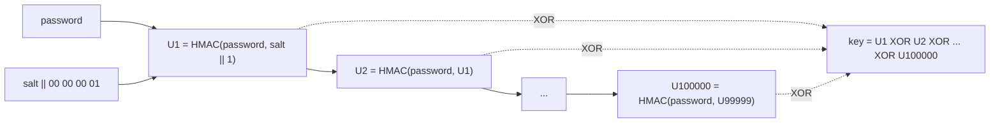
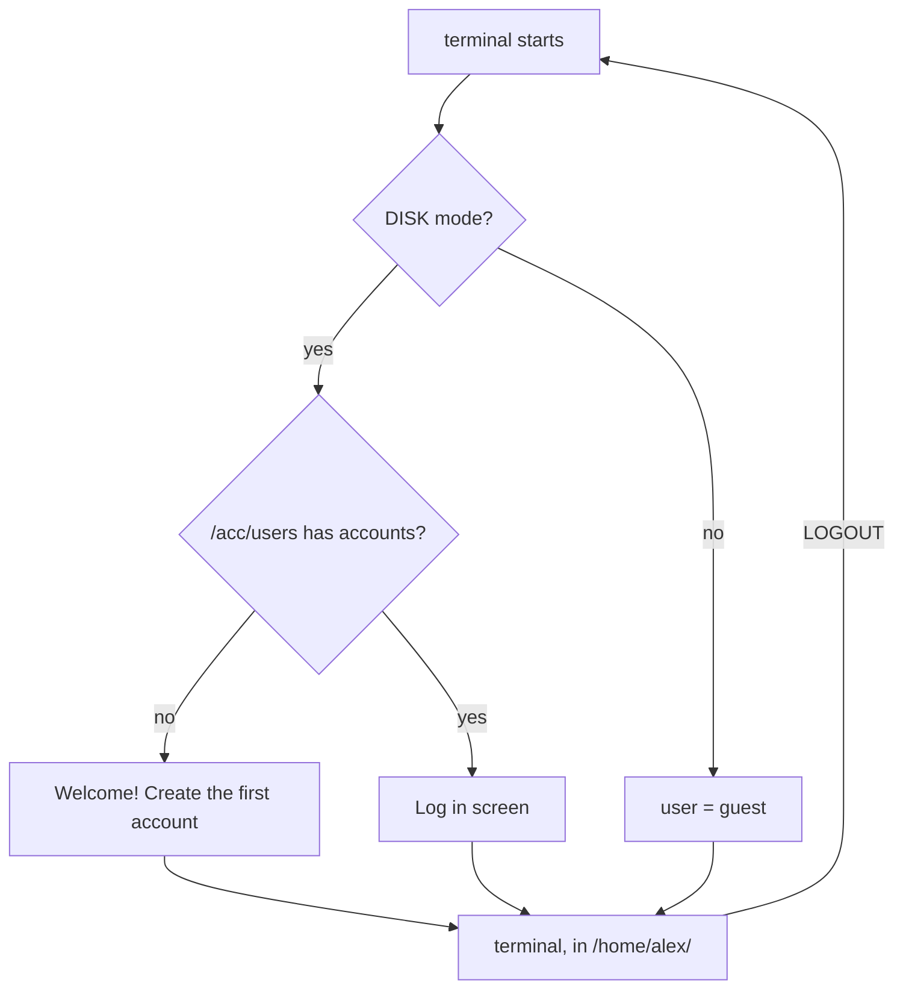
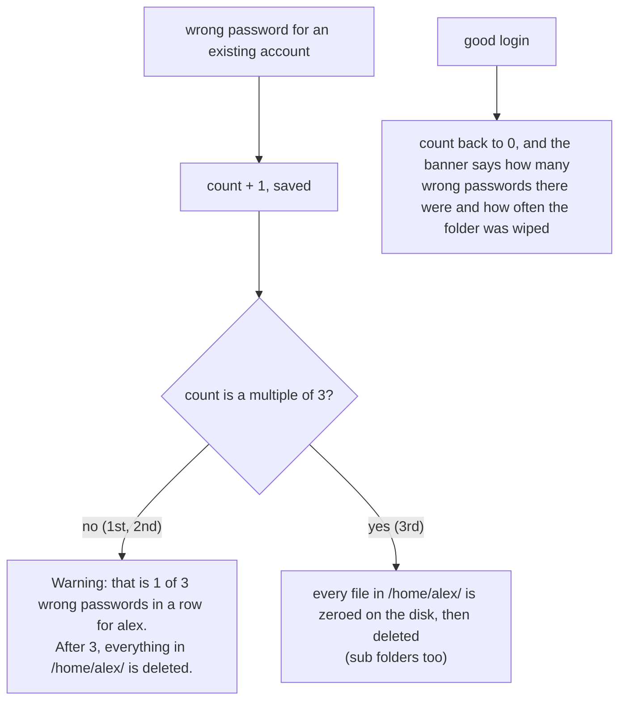
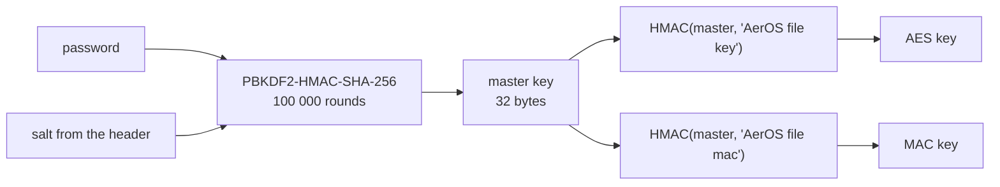
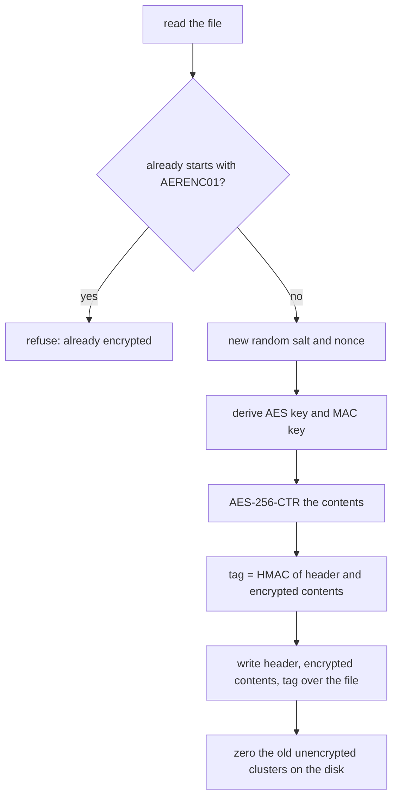
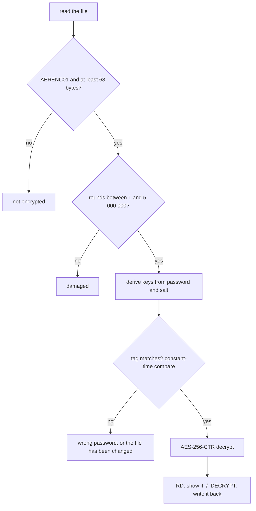

# Security in AerOS: accounts and encrypted files

This document explains, from the ground up, how AerOS protects passwords and files: which
algorithms it uses, why, how they fit together, and where their limits are. Everything described
here is in four files:

| File | What it does |
| --- | --- |
| [`src/lib/crypto.c`](../src/lib/crypto.c) | the algorithms: SHA-256, HMAC, PBKDF2, AES-256, CTR mode, random numbers |
| [`src/sys/accounts/auth.c`](../src/sys/accounts/auth.c) | user accounts and the login screen |
| [`src/sys/fcrypt.c`](../src/sys/fcrypt.c) | password protected files |
| [`src/sys/terminal/t_int.c`](../src/sys/terminal/t_int.c) | the `ENCRYPT`, `DECRYPT`, `RD`, `PASSWD`, `ADDUSER`... commands |

The crypto library is about 600 lines of C, most of it comments, written from the published
standards. Nothing is
copied from other projects and there are no hidden tables (even the AES S-box is computed). It
checks itself against the standards' official test vectors every time AerOS boots: the boot log
shows `[ OK ] Crypto self-test`.

---

## 1. The building blocks

| Algorithm | Standard | Used for |
| --- | --- | --- |
| SHA-256 | FIPS 180-4 | the hash everything else is built on |
| HMAC-SHA-256 | RFC 2104 | tamper detection, deriving keys |
| PBKDF2-HMAC-SHA-256, 100 000 rounds | RFC 8018 | turning passwords into keys and stored hashes |
| AES-256 | FIPS 197 | encrypting file contents |
| CTR mode | NIST SP 800-38A | turning AES into a stream cipher |
| SHA-256 based random generator | (AerOS design, section 5) | salts and nonces |

### SHA-256: a fingerprint of any data

SHA-256 takes any amount of data and produces a 32 byte *digest*. Change a single bit of the
input and about half the bits of the digest change. Nobody knows a way to find two inputs with
the same digest, or to get from a digest back to the input.

```
data  ->  pad to a multiple of 64 bytes  ->  split into 64 byte blocks

state = 8 fixed words (from the square roots of the first 8 primes)
for each block:
    expand its 16 words to 64
    64 rounds of add / rotate / choose / majority, using 64 constants
    state = state + result            <- adding back the old state makes it one way
digest = state (8 words = 32 bytes)
```

The padding (`0x80`, zeros, then the length in bits) makes every message end differently, so
no two messages can pad out to the same blocks.

### HMAC: a fingerprint only the key holder can make

A plain hash can be computed by anyone, so it can't prove who made it. HMAC mixes a secret key
in, twice:

```
HMAC(key, data) = SHA-256( (key XOR opad) || SHA-256( (key XOR ipad) || data ) )

    ipad = 64 bytes of 0x36      opad = 64 bytes of 0x5c      || = joined together
```

Without the key you can't produce the right HMAC for some data, and you can't change the data
and fix the HMAC up to match. AerOS uses it two ways: as the *tag* that detects tampering and
wrong passwords in encrypted files, and as a building block for PBKDF2 and for deriving keys.

*Speed-up:* the two padded keys are exactly one SHA-256 block each, so `hmac_init()` hashes
them once and keeps both half-finished states. Every HMAC with the same key then starts from
copies of those states, which halves the work inside PBKDF2.

### PBKDF2: making password guessing expensive

People choose guessable passwords. If AerOS stored `SHA-256(password)`, an attacker with the
disk could try billions of guesses a second. PBKDF2 runs HMAC in a long chain, so every guess
costs 100 000 HMACs:



The **salt** is 16 random bytes, different for every password and every encrypted file. Two
users with the same password get completely different hashes, and an attacker can't prepare a
table of common passwords in advance: each salt needs its own 100 000-round attack.

On QEMU's software CPU one PBKDF2 takes about a second. Real hardware is many times faster.
The round count is stored next to every hash and in every encrypted file, so it can be raised
later without breaking anything already saved.

### AES-256: the cipher

AES encrypts one 16 byte block with a 32 byte key. The block is treated as a 4 x 4 grid of
bytes and goes through 14 rounds:

```
add round key 0
rounds 1-13:  SubBytes -> ShiftRows -> MixColumns -> add round key n
round 14:     SubBytes -> ShiftRows ->               add round key 14

  SubBytes     each byte swapped through the S-box (the non-linear step)
  ShiftRows    row r of the grid rotated r places left
  MixColumns   the four bytes of each column mixed together
  round keys   the 32 byte key stretched to 15 x 16 bytes by the key schedule
```

After a few rounds every output bit depends on every input bit and every key bit. The S-box
is built at start-up by walking the field GF(2^8) rather than typed in as 256 numbers, which
rules out typos. The FIPS 197 test vector would catch any mistake.

### CTR mode: encrypting more than 16 bytes

AES on its own handles one block. Counter mode encrypts a counter and XORs the result with the
data:

```
 counter block n:  [ nonce (8 bytes) | n (8 bytes, big endian) ]      n = 0, 1, 2, ...
                                    |
                               AES-256(key)
                                    |
                                key stream ---XOR---> data block n  =  encrypted block n
```

* The same operation decrypts, because XORing with the same stream twice gives the original back.
* The output is exactly as long as the input, with no padding.
* **The one rule:** a key and nonce pair must never encrypt two different things. AerOS
  makes a new random salt for every encryption, so every file gets a key that has never been
  used before. The rule can't be broken even if a nonce repeats.

---

## 2. User accounts

### When a login is needed

Logging in is only required in **DISK mode**, when an AEROS disk is mounted, because that's
the only place accounts can be saved. In VFS and DEMO mode everyone is `guest`.



### The accounts file

`/acc/users` is a text file with one line per user:

```
alex:100000:ddc76e8311a11dfcb75bdea5ba79573a:7bf4cd0afe31b001a6616f92ce10caa45f9c491589c19f7c3723feac727e75e4:0
|    |      |                                |                                                                |
|    |      salt: 16 random bytes, hex       hash: PBKDF2(password, salt, rounds), 32 bytes, hex               |
|    PBKDF2 rounds for this password                                                  wrong passwords since the
user name (1-8 of a-z 0-9 _ -)                                                        last good login
```

**The password itself is never stored.** To check a login, AerOS runs the typed password
through PBKDF2 with the stored salt and rounds, then compares the result with the stored hash.

### Home folders

Every account has a home folder, `/home/<name>/`, made with the account (or at the first login
for accounts made before home folders existed). The terminal starts there after logging in.
A folder name on the disk must fit the 8.3 rule, so new user names are at most 8 characters.

### Three wrong passwords

Each account counts the wrong passwords typed for it since its last good login. The count is
saved in `/acc/users`, so turning the computer off and on again doesn't reset it.



* Only the home folder is wiped: other users' files, the apps and the system stay as they are.
  The account itself and its password stay too.
* Files are **overwritten with zeros** before they are deleted (`fs_wipe_dir` in
  `src/sys/f_sys.c`), so their contents can't be read back from the raw disk afterwards.
* A name that doesn't exist gets the plain "Wrong user name or password" message, and nothing
  is counted.

### Details that matter

| Protection | How |
| --- | --- |
| No password on disk | only the salted PBKDF2 hash is saved |
| Same password, different hash | a fresh random salt per user, and again on every `PASSWD` |
| Unknown names cost as much as real ones | `auth_check` runs a full PBKDF2 even when the name doesn't exist, so timing doesn't reveal valid names |
| Few hints | "Wrong user name or password" either way, though real accounts also get the wrong-password warning (see section 4) |
| Slow guessing at the keyboard | a 1 second pause after every wrong login |
| Guessing costs the account's files | the home folder is wiped on every 3rd wrong password in a row |
| Knowing someone tried | after a good login the banner reports the wrong passwords since the last one |
| Comparing hashes | `crypto_equal` looks at every byte, so timing doesn't reveal how much matched |
| Passwords in memory | password buffers are wiped with `crypto_wipe` as soon as they've been used |
| Passwords on screen | typed as `*`, never added to the up-arrow history |
| History between users | `LOGOUT` clears the command history and leaves the home folder |
| Damaged file | a line that doesn't parse is skipped, so one bad line can't lock everyone out |

### Commands

| Command | Does |
| --- | --- |
| `WHOAMI` | prints who is logged in |
| `USERS` | lists the accounts |
| `ADDUSER <name>` | new account and its home folder, password asked twice |
| `DELUSER <name>` | deletes an account after asking for *your own* password (you can't delete yourself) |
| `PASSWD` | your current password, then the new one twice |
| `LOGOUT` | back to the login screen |

---

## 3. Encrypted files

`ENCRYPT notes.txt` locks a file with a password. It keeps its name, and only its contents
change.

### The file format

```
0        8        12                28       36                      36+n      36+n+32
+--------+--------+-----------------+--------+-----------------------+---------+
| magic  | rounds | salt            | nonce  | encrypted contents    | tag     |
+--------+--------+-----------------+--------+-----------------------+---------+
 8 bytes  4 bytes  16 bytes          8 bytes  n bytes (same as before) 32 bytes
 \_________________ header (36 bytes) ______/

magic    "AERENC01": AerOS encrypted, format 01
rounds   PBKDF2 rounds, little endian (100000)
salt     random for every encryption
nonce    random, the first half of every CTR counter block
tag      HMAC-SHA-256(MAC key, header || encrypted contents)
```

An encrypted file is always exactly **68 bytes** bigger than the original.

### From password to keys



**Why two keys?** Using one key for two jobs (encrypting and checking) is a classic way for a
weakness in one to leak into the other. HMAC with two different labels gives two unrelated keys
from one master key.

### Encrypting



### Decrypting (and `RD` on an encrypted file)



The tag is checked **before** anything is decrypted ("encrypt-then-MAC"). A wrong password
gives different keys, so the tag doesn't match, and nothing is decrypted from a file that has
been tampered with. These two cases give the same error on purpose: telling them apart would
only help an attacker.

The 5 000 000 round limit stops a damaged or malicious header from tying the computer up for
hours.

### Safety details

| Detail | How |
| --- | --- |
| Original contents removed from the disk | after encrypting, the old FAT clusters are overwritten with zeros, not just marked free (`fat_replace_file(..., wipe_old = true)`) |
| Crash while saving | the new contents are written to fresh clusters before the directory entry is switched over, so a crash leaves either the old file or the new one, never a mix |
| Accidental damage | `WR` and `EDIT` refuse encrypted files, because changing a byte would break the tag |
| Reading without unlocking | `RD` on an encrypted file asks for the password and shows it without changing the file |
| Keys in memory | the master key, both derived keys, AES round keys and decrypted copies are wiped after use |

### Commands and AerLang

| Terminal | AerLang | Does |
| --- | --- | --- |
| `ENCRYPT <file>` | `encrypt_file(path, password)` | lock a file |
| `DECRYPT <file>` | `decrypt_file(path, password)` | unlock it again |
| `RD <file>` | `read_encrypted(path, password)` | read it without unlocking (nil if the password is wrong) |
|  | `is_encrypted(path)` | true for an encrypted file |
|  | `input_secret(prompt)` | read a password, showing `*` |

### Checking the format yourself

The format is simple enough to decrypt anywhere. This Python script (it needs
`pip install cryptography`) decrypts an AerOS file copied off the disk, for example with
`mcopy -i disk.img ::/notes.txt .`:

```python
import hashlib, hmac, sys
from cryptography.hazmat.primitives.ciphers import Cipher, algorithms, modes

data, password = open(sys.argv[1], 'rb').read(), sys.argv[2].encode()
assert data[:8] == b'AERENC01', 'not an AerOS encrypted file'
rounds = int.from_bytes(data[8:12], 'little')
salt, nonce = data[12:28], data[28:36]
contents, tag = data[36:-32], data[-32:]

master = hashlib.pbkdf2_hmac('sha256', password, salt, rounds, 32)
aes_key = hmac.new(master, b'AerOS file key', 'sha256').digest()
mac_key = hmac.new(master, b'AerOS file mac', 'sha256').digest()
if not hmac.compare_digest(hmac.new(mac_key, data[:-32], 'sha256').digest(), tag):
    sys.exit('wrong password, or the file has been changed')

counter = nonce + bytes(8)  # the counter starts at 0 in the last 8 bytes
plain = Cipher(algorithms.AES(aes_key), modes.CTR(counter)).decryptor().update(contents)
sys.stdout.buffer.write(plain)
```

---

## 4. What this does *not* protect against

Being clear about the limits is part of good security:

* **There are no file permissions yet.** Any logged in user can read, change or delete any
  file, including `/acc/users`. Deleting it makes the next boot ask for a new first account,
  which means anyone who can log in, or who can write to the disk, can take the computer over.
  Encrypted files stay safe, because their keys come from their own passwords, not from the
  accounts.
* **There are no administrator accounts.** Every user can `ADDUSER` and `DELUSER`. `DELUSER`
  asks for your own password, so it protects against someone walking up to an unlocked
  terminal, not against another user. Deleting an account leaves its home folder behind.
* **Anyone at the keyboard can wipe a home folder.** Three wrong passwords for a name is all
  it takes, so the wipe protects a folder's contents from someone guessing the password, not
  from someone who just wants to destroy them. Keep copies of anything important.
* **The warning shows which names exist.** Real accounts get the "1 of 3" warning and names
  that don't exist don't, so the login screen now reveals which user names are real.
* **Deleted names can linger.** Wiping zeros every file's contents, but the deleted entries in
  the folder still hold their (8.3) file names until something reuses them.
* **The disk is not encrypted.** Someone who plugs the disk into another computer can read all
  unencrypted files, every file and folder name and size, and the password hashes in
  `/acc/users`. PBKDF2 makes guessing those hashes slow, but a short or common password can
  still be found. Use long passwords.
* **Older copies of a file may still be on the disk.** Encrypting zeros the clusters the file
  used at that moment. But every *earlier* save of the file (FAT writes changes to new clusters
  and frees the old ones) left an unencrypted copy in free space that hasn't been overwritten.
  To keep something secret, encrypt it before it's saved many times, or on a fresh disk.
* **File names aren't protected.** An encrypted file's name isn't part of its tag, so someone
  with disk access could swap the names of two encrypted files without being noticed. The
  contents are still protected.
* **PBKDF2 is not memory-hard, and 100 000 rounds is on the low side.** Attackers with graphics
  cards guess PBKDF2 faster than memory-hard functions like scrypt or Argon2 would allow. OWASP
  currently recommends 600 000 rounds for PBKDF2-HMAC-SHA-256. AerOS uses 100 000 so logging in
  takes about a second on QEMU's emulated CPU. On real hardware, raising `AUTH_ITERATIONS` and
  `ROUNDS` (section 7) is cheap and worthwhile.
* **There is no memory protection.** AerOS runs everything in one address space, as one
  program. Secrets are wiped after use, but while a password is being typed it passes through
  the keyboard's 128-byte ring buffer, which isn't wiped.
* **AES uses table lookups.** Its timing can depend on cache behaviour. That matters on shared
  machines where an attacker runs their own code alongside yours, which AerOS doesn't allow.

---

## 5. Random numbers

Salts and nonces must be unpredictable. `crypto_random()` hashes together everything
unpredictable it can find:

```
  keyboard interrupt  --scancode + CPU cycle count-->  +
  timer interrupt     --tick + CPU cycle count------>  +--> entropy (32 bit, mixed by rotate and XOR)
                                                                 |
  RDRAND (the CPU's hardware random generator, if present) ---+  |
  the CPU cycle counter right now ----------------------------+  |
  pool (32 bytes, carried from call to call) ----------------+|  |
  a call counter -------------------------------------------+||  |
                                                            vvvv v
                                          digest = SHA-256(all of these)
                                                    |
                        first 16 bytes --> handed out    pool = SHA-256(digest)
```

* Even if one source is weak (an old CPU without RDRAND, say), the others still make the result
  unpredictable.
* SHA-256 hides any pattern in the inputs.
* Only half of each digest is handed out, and the pool moves on to a hash of the whole digest.
  So seeing the output never reveals the pool, and the pool can't be wound back to work out
  earlier output.
* By the time anyone creates an account or encrypts a file, they have typed on the keyboard.
  Every key press adds the exact CPU cycle it arrived on, which can't be predicted.

---

## 6. The self-test

`crypto_selftest()` runs at every boot and compares against the published answers:

| Test | Source |
| --- | --- |
| SHA-256 of `"abc"` (one block) | FIPS 180-4 example |
| SHA-256 of the 56-byte two-block message | FIPS 180-4 example |
| HMAC-SHA-256, key `"Jefe"` | RFC 4231 test case 2 |
| PBKDF2-HMAC-SHA-256, `"password"` / `"salt"`, 1 and 2 rounds | widely published reference values |
| AES-256 encryption of `00 11 22 ... ff` with key `00 01 ... 1f` | FIPS 197 appendix C.3 |

A mistake anywhere in the code, or a compiler problem, would turn the boot log line into
`[FAIL]`.

---

## 7. Changing things

| To change | Edit |
| --- | --- |
| PBKDF2 rounds for new passwords | `AUTH_ITERATIONS` in `auth.c` (old passwords keep their own count until changed) |
| PBKDF2 rounds for new encrypted files | `ROUNDS` in `fcrypt.c` (and `ROUNDS_MAX` if going above 5 000 000) |
| Pause after a wrong login | `WRONG_DELAY_MS` in `auth.c` |
| Allowed user names | `valid_name()` in `auth.c` (keep `:` out, it separates the fields) |
| The encrypted file format | give the new format a new magic (`AERENC02`) and keep reading `AERENC01`, so old files still open |
| Add an algorithm | add it to `crypto.c` with its official test vectors in `crypto_selftest()` |
