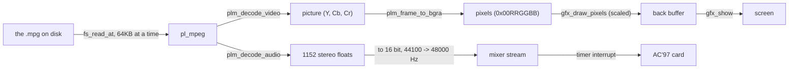

# Video in AerOS

AerOS plays MPEG-1 videos (`.mpg` files) full screen, with their sound in step. This document
explains how a video gets from the disk to the screen and the speakers, and how to change or
extend it.

| File | What it does |
| --- | --- |
| [`src/sys/video.c`](../src/sys/video.c) | the player: reading the file, the clock, showing pictures, the keys |
| [`src/lib/mpg.c`](../src/lib/mpg.c), [`mpg.h`](../src/lib/mpg.h) | builds pl_mpeg into AerOS |
| [`src/lib/pl_mpeg/`](../src/lib/pl_mpeg/) | pl_mpeg, unchanged (MIT licence, see its `LICENSE`) |
| [`src/sys/mixer.c`](../src/sys/mixer.c) | the sound mixer: the video's sound is a "stream" voice |
| [`src/drivers/video/gfx.c`](../src/drivers/video/gfx.c) | the back buffer, and `gfx_draw_pixels` for scaling each picture |
| [`src/sys/fat.c`](../src/sys/fat.c), [`f_sys.c`](../src/sys/f_sys.c) | `fat_read_at` / `fs_read_at`: reading part of a file |
| [`src/lib/fpu.c`](../src/lib/fpu.c) | switches the FPU on (the sound decoder uses floats) |

## Using it

| Where | How |
| --- | --- |
| terminal | `PLY clip.mpg` (the same command as for sounds: AerOS looks inside the file to tell) |
| AerLang | `video("clip.mpg")` plays it and comes back when it ends, true if it played |
| keys | Esc or Ctrl+C stop, Space pauses, Left / Right skip 5 seconds, any other key shows the controls |
| try it | `PLY /bin/sample.mpg`, a 6 second built-in clip |

Making a file AerOS plays, with ffmpeg:

```bash
ffmpeg -i in.mp4 -c:v mpeg1video -q:v 4 -s 640x360 -c:a mp2 -f mpeg out.mpg
make disk-put FILE=out.mpg          # from src/, copies it onto the AEROS disk
```

Videos need a framebuffer (boot the ISO). Under `-kernel` QEMU is in VGA text mode, and
`PLY` says the screen is text only.

## Why MPEG-1

| Format | For AerOS |
| --- | --- |
| **MPEG-1 video + MP2 sound** | patents expired, a small single-file decoder (pl_mpeg), cheap enough to decode on one core without vector instructions |
| Theora, VP8 (WebM) | royalty free, but the decoders are much bigger libraries |
| H.264, AV1, VP9 | patents (H.264), or far too heavy without SIMD and several cores |

## From the disk to the screen and speakers



### Reading the file a piece at a time

pl_mpeg is handed three callbacks instead of a file name (`plm_buffer_create_with_callbacks`):

| Callback | AerOS does |
| --- | --- |
| load | reads the next `READ_CHUNK` (64 KB) with `fs_read_at` and gives it to `plm_buffer_write` |
| seek | remembers the offset the next load starts from |
| tell | says how far the loads have got |

`fat_read_at` (in `fat.c`) follows the file's cluster chain to the right place. It remembers the
cluster it read last (`fat_file_t`), so reading straight through a long video never walks the
chain from the start again. Whole sectors are read straight into the caller's buffer, several at
a time; only the ends of a read go through a spare sector.

One trap, written down in `load_more()`: at the end of the file the load callback simply hands
over nothing. pl_mpeg's `plm_buffer_signal_end()` must **not** be used there: it records the end
as "however much the buffer holds right now", the decoder reads the end of the file once when it
starts (to learn the length), and that stale value later makes it stop reading early, which
breaks seeking.

### Showing a picture

1. `plm_decode_video` gives the next picture as three planes, Y (brightness) and Cb, Cr
   (colour, at half the size each way).
2. `plm_frame_to_bgra` turns it into 4 bytes a pixel: blue, green, red, alpha. Read as one
   little endian 32 bit number that is `0xAARRGGBB`, the same layout as a 32 bit screen.
3. `gfx_draw_pixels` scales it into the back buffer: it works out once which source column
   each screen column comes from, and copies a whole row with `memcpy` when the row below comes
   from the same source row.
4. `gfx_show` copies the finished frame to the screen in one go (no flicker).

The picture is made as big as fits, keeping its shape, and centred (`fit_picture`).

### The sound, and keeping the two together

The sound is decoded as blocks of 1152 stereo floats (-1 to 1) at the file's rate, usually
44100 Hz. `convert_sound` turns them into 16 bit at the mixer's 48000 Hz, drawing a straight
line between neighbouring samples (the position between samples is carried from one block to
the next, so the joins are seamless). The player keeps about a quarter of a second queued in a
mixer **stream** voice: a ring buffer that the timer interrupt plays from, so the sound carries
on however long a picture takes to decode.

**The sound is the clock.** Sound can't be skipped or held without being heard; a picture can
be shown a little late, or not at all, without anyone noticing. So

```
time now = time of the first sound written + (frames the mixer has played - frames still queued on the card) / 48000
```

and each picture is shown once `time now` reaches the time it carries. A picture more than a
frame late is dropped (not drawn) to catch up, but at least one is shown every 200 ms, so a
video too big for the computer plays jerkily instead of looking frozen. A video without sound,
or after its sound ends, uses the system timer instead.

| Key | What the player does |
| --- | --- |
| Space | pauses the mixer voice (it keeps its place) and stops feeding it |
| Left / Right | `plm_seek` to the nearest whole picture 5 seconds away, empties the mixer stream (`mixer_stream_clear`), and starts the clock again from the new place |

## How fast

Measured in QEMU without hardware acceleration (TCG), which is several times slower than a real
PC. The player prints a line like this on the serial port after every video:

```
video: /m640.mpg 640x360, 242 pictures shown, 6 dropped, 9 ms to decode one
```

| Size | ms to decode a picture (QEMU) | Result at 25 pictures a second (40 ms each) |
| --- | --- | --- |
| 320 x 240 | under 1 | smooth |
| 480 x 270 | 6 | smooth |
| 640 x 360 | 9 | smooth |
| 1280 x 720 | 36 to 39 | about 7 pictures a second, sound still smooth |

To see what a real PC would do, QEMU can use the processor directly with KVM: in WSL that needs
`sudo usermod -aG kvm $USER` once (then restart WSL), and `-enable-kvm` on the QEMU command line.

## Testing

```bash
# a test video: a white flash and a 1 kHz beep at the start of every second
ffmpeg -f lavfi -i "color=c=black:s=320x240:r=25:d=6,drawbox=x=0:y=0:w=320:h=240:color=white:t=fill:enable='lt(mod(t,1),0.08)'" \
       -f lavfi -i "aevalsrc=exprs='if(lt(mod(t,1),0.08),0.8*sin(2*PI*1000*t),0)':s=44100:d=6" \
       -c:v mpeg1video -q:v 4 -c:a mp2 -f mpeg sync.mpg
```

Record what the card plays with `-audiodev wav,id=snd0,path=out.wav -device AC97,audiodev=snd0`:
the beeps in `out.wav` should be exactly a second apart, with no gaps between.

## Extending it

* **Other formats**: anything that can produce pictures and sound can reuse the player's pieces:
  `gfx_draw_pixels` for pictures, a mixer stream for sound, `fs_read_at` for reading. A new
  decoder only replaces the pl_mpeg calls in `video.c`.
* **Faster decoding**: the kernel is built without SSE (`-mno-sse`). Turning SSE on (CR4 bits,
  and saving the SSE registers on interrupts) would let the colour conversion and scaling work on
  several pixels at once.
* **Smoother large videos**: `gfx_draw_pixels` and `plm_frame_to_bgra` could be merged, converting
  straight from Y, Cb, Cr into the back buffer, saving one pass over every picture.
